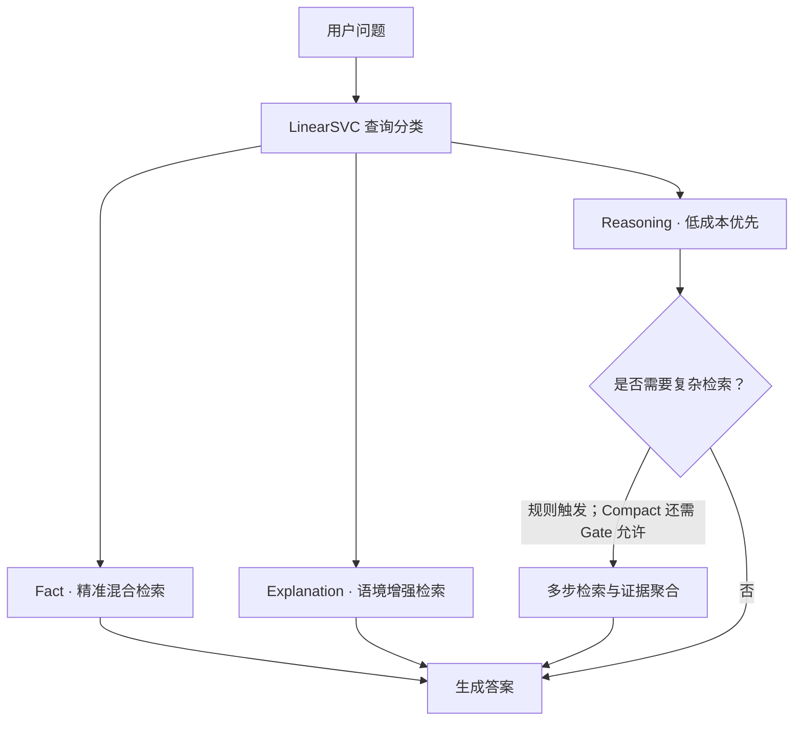

# ReasonRoute

### 不同问题，走不同的检索路径。

并非每道题都需要多轮检索，也并非少量证据足以回答所有问题。

**ReasonRoute** 根据查询的证据需求，在事实检索、语境增强和条件式推理之间选择路径。**Quality / Compact** 两种模式，让回答质量与 Token 成本有不同的取舍。

---

## 一张图看懂



## 一个方法，两种选择

| | Quality | Compact |
| --- | --- | --- |
| 侧重点 | 回答质量优先 | Token 成本优先 |
| 上下文 | 较宽松的证据保留 | 更紧凑的筛选与句子压缩 |
| 推理分支 | 条件触发多步检索 | 规则检查与独立 Gate 共同控制 |

两种模式共享查询分类和检索基础能力，具体参数见 `configs/`。Compact 不保证每个样本都更省 Token，也不保证与 Quality 具有相同准确率。

## 为什么这样做？

- **按需检索**：简单问题不必无条件进入复杂推理流程。
- **轻量路由**：LinearSVC 在本地预测，分类阶段不消耗 LLM Token。
- **条件升级**：先尝试低成本回答，必要时才补充多轮证据。
- **过程可追踪**：保存逐样本答案、路由、Token 用量及配置指纹。

## 快速开始

```bash
git clone https://github.com/lmy020520/reasonroute.git
cd reasonroute
python -m venv .venv
```

激活虚拟环境，再安装依赖：

```bash
python -m pip install -r requirements.txt
python scripts/run_reasonroute.py --help
```

通过环境变量设置 `DEEPSEEK_API_KEY` 和 `SILICONFLOW_API_KEY`，名称与端点参考 [.env.example](.env.example)。程序不会自动加载 `.env`。

> 数据、训练后的模型、知识库及索引需自行准备。安装依赖后不能直接运行完整评测；API 调用会产生费用。

## 从哪里看代码？

| 入口 | 内容 |
| --- | --- |
| [reasonroute/](reasonroute/) | 查询分类、运行调度、检索与证据处理 |
| [configs/](configs/) | Quality / Compact 配置 |
| [tools/](tools/) | 数据准备、索引构建与模型训练 |
| [scripts/run_reasonroute.py](scripts/run_reasonroute.py) | 主评测与 Gate 收益标注入口 |
| [tests/](tests/) | 离线回归测试 |

推荐顺序：**准备数据 → 训练分类器 → 构建索引 → 标注并训练 Gate（Compact）→ 运行评测**。各入口支持 `--help`。

## 本地检查

```bash
python -m unittest discover -s tests -v
python scripts/check_imports.py
```

## 关于复现

主评测使用分类器的**预测标签**路由；训练、Gate 开发和测试问题需按代码要求去重。结果以实际运行日志为准，不直接沿用历史成绩。

仓库不包含数据集、实验结果、密钥和外部基线的完整实现。RAG Token 累计生成流程中 API 返回的 `usage.total_tokens`，不含分类、嵌入、重排序和外部评价器开销。

---

**把复杂检索留给需要它的问题。**

